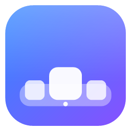
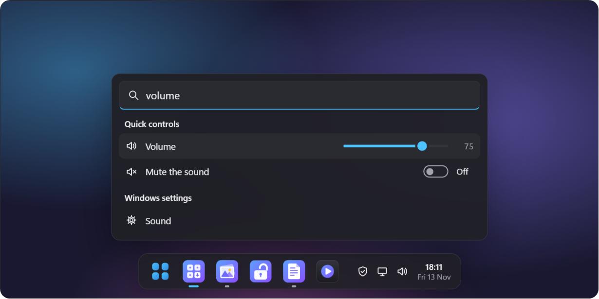

#  HeMiDock

[](https://github.com/Hemal1k/HeMiDock/releases/latest) [](https://github.com/Hemal1k/HeMiDock/releases) [](LICENSE) 

A replacement of the Windows taskbar for Windows 10 and 11: a dock with the apps, the notification area, status icons and the
clock, its own Start menu, a control center, a calendar with the notifications and a window manager. Light
and dark.

**[Download](https://github.com/Hemal1k/HeMiDock/releases/latest)** · [Project page](https://hemal1k.github.io/hemidock.html) · [Report a problem](https://github.com/Hemal1k/HeMiDock/issues)



> The downloads are not code-signed, so Windows SmartScreen may warn the first time (More info → Run anyway). Each release has `SHA256SUMS.txt` to check them.

## Download

| File | For |
|---|---|
| `HeMiDock-Setup.exe` | The installer – just for you (no administrator) or for all users (Program Files); downloads the .NET 10 Runtime and the Windows App Runtime 2.6 when they are missing. New versions are offered by the app itself (or by [HeMi Launcher](https://github.com/Hemal1k/HeMiLauncher) when it is installed). |
| `HeMiDock-Portable.zip` | Runs from any folder, nothing to install (everything inside, bigger). Updates by hand – or by HeMi Launcher. |
| `HeMiDock-Portable-arm64.zip` | The same for Windows on ARM. |

Requirements: Windows 10 2004 or newer / Windows 11, x64 or ARM64.

## Features

- **Dock** at any edge of the screen in place of the taskbar: pinned and running apps with window previews, magnification, the
  notification area, status icons (network, Bluetooth, volume, battery, keyboard language, microphone / camera / location in use,
  Windows Security, updates waiting), the clock, virtual desktops, system monitor, Recycle Bin, Downloads, Show desktop.
- **Top bar** (optional, like macOS) with the system menu, the active app and now playing.
- **Start menu** in three looks; search of apps, Windows settings, files, calculations and conversions; quick controls right in the results ("volume", "wifi", "power mode", "lock"…); quick search
  (Alt + Space); the Start button menu (Win + X).
- **Control center**: quick buttons, sound with a mixer of apps, brightness, battery and power mode, media (every app that plays, to switch between), Wi-Fi networks to connect to, Bluetooth devices – also adding new ones –, scheduled shutdown.
- **Calendar** with the notifications of Windows and the events of Outlook or an internet calendar.
- **Window manager**: zones, always on top, workspaces, rules for apps.
- **Keyboard shortcuts** for every action; settings with search, export / import and automatic backups.
- **English and Czech** – follows the language of Windows, or set it in Settings → General. The installer is in English and Czech too.

## Network

HeMiDock connects to the internet only for these:

- **Updates** – the GitHub API (`api.github.com`) for a newer release, when looking for updates is on (or on Check now), and GitHub for the download.
- **Weather** (off by default) – [Open-Meteo](https://open-meteo.com): the name of the city for the search, then its coordinates for the weather.
- **Currency conversion** – when you convert a currency in the search: the daily exchange rates of the European Central Bank (`ecb.europa.eu`), at most every 12 hours.
- **Internet calendar** – only the `.ics` address you enter.
- **Web pages pinned to the dock** – when you drop a web address on the dock: that page and its icon (`favicon.ico`), for the icon of the pin.
- **Windows App Runtime** – downloaded from Microsoft when it is missing (asked first).

## Building

Needs Windows 10 / 11 with the [.NET 10 SDK](https://dotnet.microsoft.com/download/dotnet/10.0) and the
[Windows App Runtime 2.6](https://learn.microsoft.com/windows/apps/windows-app-sdk/downloads) (x64).

```
dotnet build HeMiDock.slnx
```

Everything the build makes goes to `build\`; the app runs from `build\bin\HeMiDock\debug_win-x64\HeMiDock.exe`.
Stop a running dock first (`HeMiDock.exe --exit`) – it keeps its files open.

Command line: `--open start|search|control|calendar|settings[:page]`, `--exit`, `--measure` (start times and load into
`%AppData%\HeMi\HeMiDock\Logs\log.txt`). Debug builds only: `--selftest`, `--cycle`, `--simulate battery=34,charging,wifi,bluetooth,cellular`.

## Releases

`release.ps1` builds the downloads into `build\dist` (needs [Inno Setup 6](https://jrsoftware.org/isinfo.php) as well):
the installer (`installer\HeMiDock.iss`) and the portable zip. A release published on GitHub runs the same script in
`.github\workflows\release.yml` and gets the files attached. The version is `<Version>` in `src\HeMiDock.csproj`; the app
looks for newer releases through the GitHub API (`src\Logic\Updater.cs`).

## Project

One project, `src\HeMiDock.csproj` (WinUI 3, Windows App SDK 2.6, .NET 10, unpackaged), in `HeMiDock.slnx`.

| Folder | Contents |
|---|---|
| `src` | Start-up (`Program`, `App`), the dock (`DockWindow` in parts: `.Apps`, `.Drag`, `.Status`, `.Popups`, `.Place`), the top bar, commands of the logic (`HostCommands`). |
| `src\Popups` | Start menu, quick search, control center, calendar. |
| `src\Settings` | The settings window and its pages, the setup guide, the zone editor. |
| `src\Ui` | Shared parts: pop-up window, theme brushes and acrylic, animations, tray icons, status icons (`StatusParts`, one implementation for the dock and the top bar), pictures. |
| `src\Logic` | Logic without UI: settings, translations (`Loc`), apps and search, windows and zones, shortcuts, sound, network, battery, Bluetooth, updates, diagnostics. |
| `src\Shell` | The taskbar side of the shell: tray icons and app windows (`ShellHost`), app bar, task list, zones overlay; `Shell\ManagedShell` holds parts of [ManagedShell](https://github.com/cairoshell/ManagedShell) (Apache License 2.0), changed to run without WPF and Windows Forms. |
| `installer` | The Inno Setup script of the installer. |

How the parts work together:

- The logic asks the UI for things through `Host` (`src\Logic\Host.cs`) and hands work back to the UI thread with `Ui.Post`.
- Pop-ups are `PopupWindow`s in a `PopupHost`; animations run on the compositor (`src\Ui\Motion.cs`).
- Settings are the properties of `DockSettings` (`src\Logic\Settings.cs`), stored in `%AppData%\HeMi\HeMiDock\settings.json`;
  texts are English in the code and translated in `src\Logic\Loc.cs`.

Problems and ideas are welcome in [Issues](https://github.com/Hemal1k/HeMiDock/issues).

## License

[MIT](LICENSE). Parts of `src\Shell\ManagedShell` come from [ManagedShell](https://github.com/cairoshell/ManagedShell)
(Apache License 2.0, see the LICENSE and NOTICE there).
